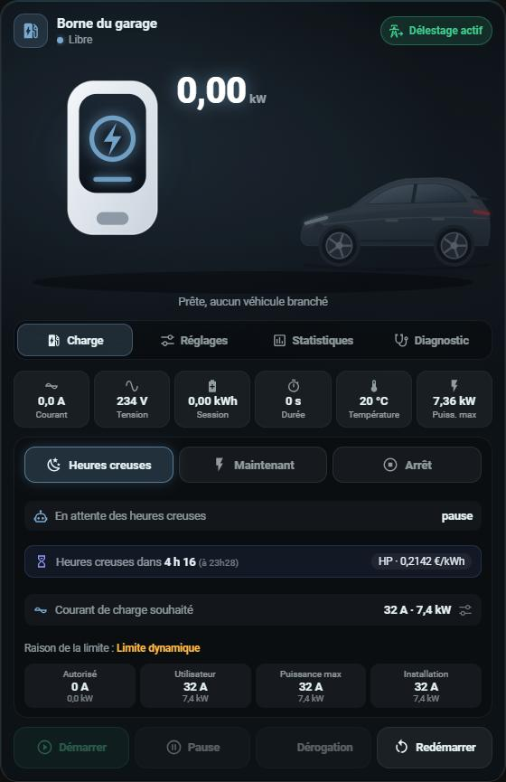
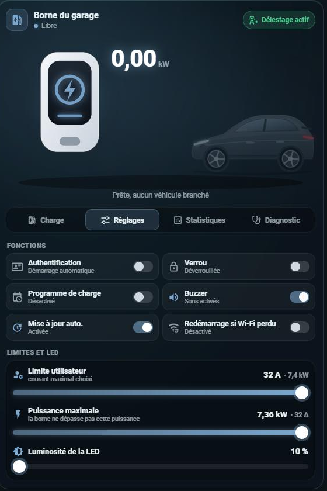
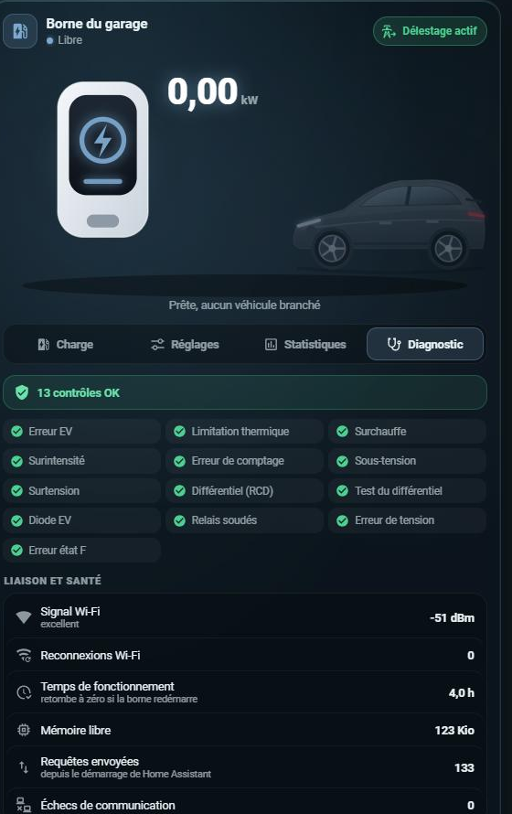
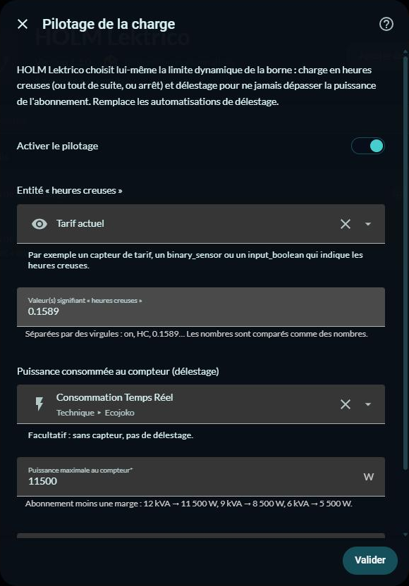

# ⚡ HOLM Lektrico

[](https://hacs.xyz/)


[🇫🇷 Français](README.md) · 🇬🇧 English

**Your Lektrico charger (1P7K, 3P22K) in Home Assistant, locally, without overloading it, with its card, off-peak charging and load shedding built in.**

HOLM Lektrico replaces the official Lektrico integration. It talks to the charger through its **local API** (firmware JSON-RPC) but polls it **sparingly**. On some chargers, the official integration's heavy polling (3 to 4 requests every 10 seconds, connections kept open, automatic discovery) ends up locking the charger's network stack. It then drops off the Wi-Fi until a power cut.

### At a glance

- 🐢 **Thrifty**: at most 2 requests per cycle, every 30 s by default (adjustable from 15 to 300 s). One request at a time, and the connection is closed after each reply.
- 🔁 **Slow data on rotation**: only one per cycle. Charger settings every 2 min (a power changed in the Lektrico app shows up quickly), Wi-Fi and counters every 5 min, system currents every other cycle.
- 🛟 **Automatic back-off**: if the charger answers badly, the interval doubles on each failure (60, 120, 240 s… up to 5 min), then goes back to normal as soon as it answers.
- 🙅 **No automatic discovery**: the charger is only added with its IP address, when you decide.
- 🧩 **All entities**: state, measurements, detailed faults, system currents, Wi-Fi, counters, settings and commands.
- 🎴 **HOLM Charger card included**, registered automatically.
- 🔌 **Built-in charge control**: off-peak charging, “now” or stop, and load shedding to never exceed your contract power, with no automation.
- 🔗 **Compatible** with the official integration's IDs: your cards and automations keep working.
- 🌍 **8 languages**: English, French, German, Spanish, Italian, Dutch, Portuguese and Polish (integration and card).

| Charge and control | Settings | Diagnostics |
|---|---|---|
|  |  |  |

*Screenshots in French — the card follows the language of your Home Assistant profile.*

### 🆕 What's new in 1.3.0

- 🌍 **8 languages**: the integration (setup, options, entities, actions) is translated into English, French, German, Spanish, Italian, Dutch, Portuguese and Polish, following the language of Home Assistant. The **HOLM Charger** card too, editor included; its `language` option lets you force a language.
- 🇬🇧 English README.

---

## Installation

### Via HACS (recommended)

1. HACS → ⋮ menu → **Custom repositories** → add `https://github.com/kaaribou/lektrico-holm`, category **Integration**.
2. Search for **HOLM Lektrico** and install.
3. Restart Home Assistant.

### Manually

Copy the `custom_components/lektrico_holm` folder into the `custom_components` folder of your configuration, then restart Home Assistant.

## Configuration

> ⚠️ First remove the official Lektrico integration (and ignore its automatic discovery). Two integrations polling the same charger double the load.

Settings → Devices & services → **Add integration** → **HOLM Lektrico**:

- **Charger IP address**: reserve a fixed address for it in your router.
- **Device name**: “Borne de recharge” by default.
- **Entity prefix**: `garage_borne_de_recharge` by default. Entities are then named `sensor.garage_borne_de_recharge_etat`, `number.garage_borne_de_recharge_limite_dynamique`… Keep your old entities' prefix so your cards and automations find them.

**Options**: polling interval (30 s by default).
**Reconfigure**: change the IP address without starting over.

## Entities

| Type | Entities |
|---|---|
| **Sensors** | State, power, session energy, lifetime energy, charging time, temperature, current, voltage, installation current, limit reason; three-phase: currents and voltages L1 to L3 |
| **Diagnostics** | IEC 61851 state, PWM current, free memory, uptime, system currents (allowed charging, maximum, schedule, temperature, user power), Wi-Fi signal, Wi-Fi reconnections, IP address, requests sent, communication failures |
| **Counters** | Number of sessions, total charging time, last session energy |
| **Faults** | EV error, thermal limiting, overheating, overcurrent, metering error, undervoltage, overvoltage, RCD, RCD test, EV diode, welded relay, voltage error, state F error |
| **States** | Vehicle connected, charging, paused, schedule override active, active errors, Wi-Fi connected |
| **Settings** | Authentication, lock, charging schedule, automatic update, buzzer, restart on Wi-Fi loss, dynamic limit (0–32 A), user limit (6–32 A), maximum power, LED brightness and dimming |
| **Commands** | Start, stop, pause, resume, schedule override, restart |

Some advanced entities are disabled by default (MQTT, energy management, LED colours, precise PWM, vehicle minimum current, installation current, energy reset…). Enable them from the device page if needed. Data a firmware doesn't provide is detected and no longer requested.

*Entity IDs keep the French suffixes (`_etat`, `_puissance`…) for compatibility.*

### Energy dashboard

In **Individual devices**, add `sensor.<prefix>_energie_totale`, the charger's cumulative counter in kWh, and `sensor.<prefix>_puissance` as instantaneous power.

## 🎴 The HOLM Charger card

The card comes with the integration and is registered automatically in the dashboard resources. If a `holm-borne-card.js` resource already exists, the integration doesn't add a second one.

```yaml
type: custom:holm-borne-card
entity: sensor.garage_borne_de_recharge_etat
name: Garage charger
# with built-in charge control, the charge mode and the Load shedding button show up on their own
```

- **Animated illustration** charger → cable → car depending on the state, power in large type.
- **Charge**:
  - measurements (current, voltage, energy, duration, temperature, maximum power);
  - charging limit in A and kW, limit reason, allowed, user, power and installation limits;
  - Start, Stop, Pause, Resume, Override buttons, and Restart with confirmation.
- **Control**: Off-peak hours / Now / Stop modes, control state and applied limit, reminder of the desired charging current (a tap leads to the Settings tab).
- **Off-peak countdown**: in Off-peak mode, “Off-peak in 4 h 16 (at 23h28)” and the current price, or “Off-peak until 05h28” during off-peak hours. With [HOLM HP/HC](https://github.com/kaaribou/holm-tarif), it's automatic; without it, nothing changes.
- **Settings**: the desired charging current (6 to 32 A, with shortcuts and kW equivalent), all the charger's switches and the user limit, maximum power, vehicle minimum current and LED sliders.
- **Your photo** instead of the illustration (media library or image address, fill or whole-image framing): glowing outline and animated bar while charging, fixed bar when the vehicle is plugged in, blinking outline on error.
- **Protected from accidental gestures**: sliders only move by grabbing the knob and dragging it; a tap on the track or a page scroll changes nothing.
- **Statistics**: total energy, sessions, charging time, last session, average per session.
- **Diagnostics**: fault checks, Wi-Fi signal, link health and internal currents.

Options: `language` (card language: `fr`, `en`, `de`, `es`, `it`, `nl`, `pt`, `pl`; the profile's by default), `name`, `delestage_entity`, `hc_entity` (off-peak hours for the countdown, found automatically), `image_media` / `image` (photo), `image_fit` (`cover` or `contain`), `default_tab` (`charge`, `settings`, `stats`, `diag`), `show_settings`, `show_diagnostic`, `car_color` (car colour, e.g. `#4a5d70`), `phases` (`1` or `3`, for the kW equivalent), `voltage` (nominal voltage, 230 by default). The visual editor is available.

The card also works with the official Lektrico integration: entities are found from the device of the “State” entity.

## 🔌 Charge control: off-peak hours and load shedding

HOLM Lektrico can **drive the charger itself**, without any automation: Settings → Devices & services → HOLM Lektrico → **Configure** → **Charge control**.



| Setting | Role |
|---|---|
| **Enable charge control** | Creates the charge mode, the Load shedding switch, the charging current and the Control sensor. |
| **Off-peak entity** | An entity telling off-peak hours: tariff sensor, `binary_sensor`, `input_boolean`… Recommended: `binary_sensor.heures_creuses` from [HOLM HP/HC](https://github.com/kaaribou/holm-tarif) (value `on`), which also gives the card the countdown to the next off-peak hours. |
| **Value(s) meaning off-peak** | For example `on`, `HC` or the off-peak kWh price (`0.1589`); numbers are compared as numbers. |
| **Grid power at the meter** | Optional, for load shedding: Linky/TIC, Ecojoko, Shelly EM… in W. |
| **Maximum power at the meter** | Contract minus a margin: 12 kVA → 11,500 W, 9 kVA → 8,500 W, 6 kVA → 5,500 W. |
| **Charger maximum current** | 32 A by default. |

**Entities created:**

- `select.<prefix>_mode_de_charge`:
  - **Off-peak hours**: the car charges during off-peak hours, and stays paused outside them;
  - **Now**: charges right away, for an unplanned departure; the mode goes back to Off-peak as soon as the car is unplugged;
  - **Stop**: no charging.
- `number.<prefix>_courant_de_charge`: the desired current (6 to 32 A).
- `switch.<prefix>_delestage`: during a session, the limit follows the power measured at the meter so you never exceed your contract. It drops immediately if the home uses more and rises at most once a minute; charging pauses below 6 A and resumes from 7 A; if the meter stops answering for 5 minutes, it is capped at 16 A.
- `sensor.<prefix>_pilotage`: what the control is doing.

The limit written to the charger is always `min(charging current for the mode, load-shedding cap)`: the dynamic limit is managed by the integration, don't change it elsewhere.

> 💡 Turn off the charger's own **charging schedule** (“Charging schedule” switch): it would fight the Off-peak mode.

The HOLM Charger card then shows the three modes, the control state and, in Off-peak mode, the countdown to the next off-peak hours; the charging current (6 to 32 A, with shortcuts) is set in its Settings tab, and its Load shedding button drives the built-in switch.

**Were you using the load-shedding automations from version 1.0?** Enable charge control, then disable them: they would write to the same limit.

## FAQ

**The charger still drops off the network.** Check that the official integration is removed, that the charger's web page isn't left open (it refreshes continuously), and increase the interval in the options. The “Communication failures” sensor and the downloadable diagnostics help follow the situation.

**The temperature differs by a tenth from the app.** The Lektrico app rounds to the degree. The sensor and the card show whole degrees too.

**Dynamic limit or user limit?** The user limit is your permanent ceiling (as in the app). The dynamic limit is the one set by the charge control (off-peak, load shedding) or your automations: 0 = pause. The charger applies the lower of the two.

> Not affiliated with Lektrico.

---

## Say thanks?

Like the integration? You can buy me a beer 🍺

[](https://paypal.me/kaaribou)

---

## License

Code: **MIT** license — © kaaribou. See the [CHANGELOG](CHANGELOG.md) (in French).

Part of **HOLM — Home Orchestration & Living Management**: smart management and orchestration of the home.

Other projects: [Carburant HOLM](https://github.com/kaaribou/carburant-holm) · [Climat HOLM](https://github.com/kaaribou/climat-holm) · [Volets HOLM](https://github.com/kaaribou/volets-holm) · [HOLM HP/HC](https://github.com/kaaribou/holm-tarif) · [HOLM LaMetric](https://github.com/kaaribou/lametric-holm) · [HOLM My Menu](https://github.com/kaaribou/holm-mymenu) · [HOLM Cars](https://github.com/kaaribou/holm-cars) · [HOLM GitHub](https://github.com/kaaribou/github-holm) · [HOLM Navbar Card](https://github.com/kaaribou/holm-navbar-card) · [HOLM Climate Card](https://github.com/kaaribou/climate-card-holm) · [HOLM Music Card](https://github.com/kaaribou/holm-music-card) · [HOLM Energy Cards](https://github.com/kaaribou/holm-energy-cards) · [HOLM Power Flow Card](https://github.com/kaaribou/holm-power-flow-card) · [HOLM Ecojoko Card](https://github.com/kaaribou/holm-ecojoko-card) · [HOLM Runtime Card](https://github.com/kaaribou/holm-runtime-card) · [HOLM Covers Card](https://github.com/kaaribou/holm-covers-card) · [HOLM Floor Card](https://github.com/kaaribou/holm-floor-card) · [HOLM Radiator Card](https://github.com/kaaribou/holm-radiator-card) · [HOLM Security Card](https://github.com/kaaribou/holm-security-card) · [HOLM Sentinel Card](https://github.com/kaaribou/holm-sentinel-card) · [HOLM Recordings Card](https://github.com/kaaribou/holm-recordings-card) · [HOLM Smoke Card](https://github.com/kaaribou/holm-smoke-card) · [HOLM Family Card](https://github.com/kaaribou/holm-family-card) · [HOLM Govee Light Card](https://github.com/kaaribou/holm-govee-light-card) · [HOLM Leapmotor Card](https://github.com/kaaribou/holm-leapmotor-card).
