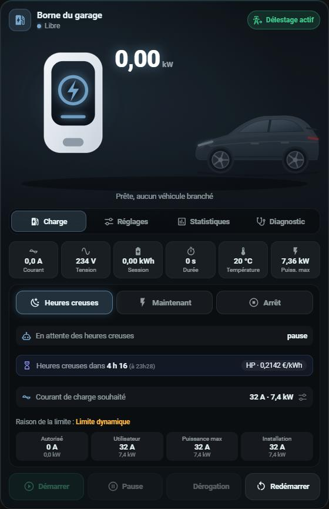
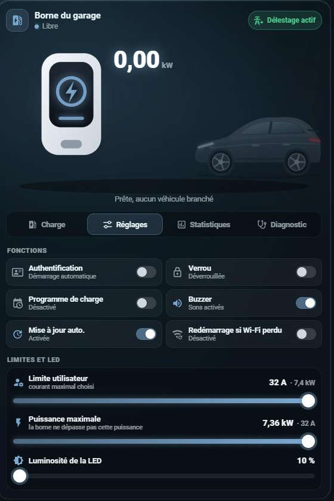
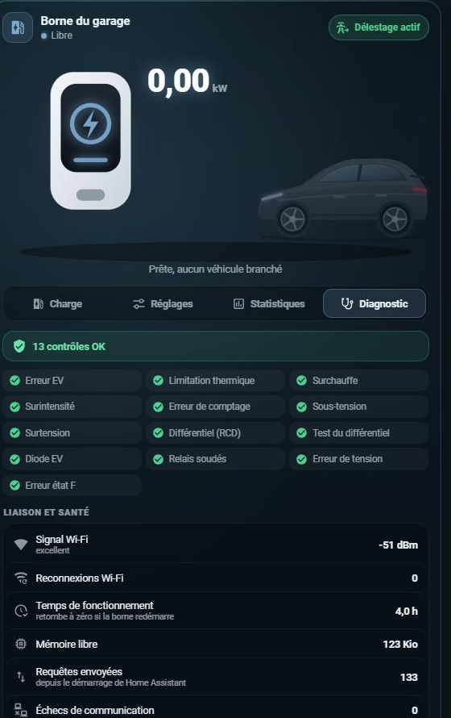
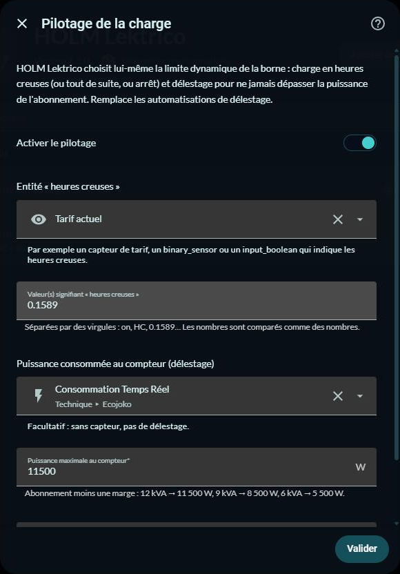

# ⚡ HOLM Lektrico

[](https://hacs.xyz/)


**Votre borne Lektrico (1P7K, 3P22K) dans Home Assistant, en local, sans la surcharger, avec sa carte, la charge en heures creuses et le délestage intégrés.**

HOLM Lektrico remplace l'intégration Lektrico officielle. Elle parle à la borne par son **API locale** (JSON-RPC du micrologiciel) mais l'interroge **avec parcimonie**. Sur certaines bornes, l'interrogation intensive de l'intégration officielle (3 à 4 requêtes toutes les 10 secondes, connexions maintenues ouvertes, détection automatique) finit par bloquer la pile réseau de la borne. Elle disparaît alors du Wi-Fi jusqu'à une coupure de courant.

### En bref

- 🐢 **Économe** : 2 requêtes au plus par cycle, toutes les 30 s par défaut (réglable de 15 à 300 s). Une seule requête à la fois, et la connexion est refermée après chaque réponse.
- 🔁 **Données lentes en tourniquet** : une seule par cycle. Réglages de la borne toutes les 2 min (une puissance changée dans l'application Lektrico remonte vite), Wi-Fi et compteurs toutes les 5 min, courants système un cycle sur deux.
- 🛟 **Recul automatique** : si la borne répond mal, l'intervalle double à chaque échec (60, 120, 240 s… jusqu'à 5 min), puis revient à la normale dès qu'elle répond.
- 🙅 **Aucune détection automatique** : la borne n'est ajoutée qu'avec son adresse IP, quand vous le décidez.
- 🧩 **Toutes les entités** : état, mesures, défauts détaillés, courants système, Wi-Fi, compteurs, réglages et commandes.
- 🎴 **Carte HOLM Borne incluse**, déclarée automatiquement.
- 🔌 **Pilotage intégré** : charge en heures creuses, « maintenant » ou arrêt, et délestage pour ne jamais dépasser votre abonnement, sans automatisation.
- 🔗 **Compatible** avec les identifiants de l'intégration officielle : vos cartes et automatisations continuent de fonctionner.

| Charge et pilotage | Réglages | Diagnostic |
|---|---|---|
|  |  |  |

---

## Installation

### Via HACS (recommandé)

1. HACS → menu ⋮ → **Dépôts personnalisés** → ajoutez `https://github.com/kaaribou/lektrico-holm`, catégorie **Intégration**.
2. Recherchez **HOLM Lektrico** et installez.
3. Redémarrez Home Assistant.

### Manuelle

Copiez le dossier `custom_components/lektrico_holm` dans le dossier `custom_components` de votre configuration, puis redémarrez Home Assistant.

## Configuration

> ⚠️ Supprimez d'abord l'intégration Lektrico officielle (et ignorez sa détection automatique). Deux intégrations qui interrogent la même borne doublent la charge.

Paramètres → Appareils et services → **Ajouter une intégration** → **HOLM Lektrico** :

- **Adresse IP de la borne** : réservez-lui une adresse fixe dans votre routeur.
- **Nom de l'appareil** : « Borne de recharge » par défaut.
- **Préfixe des entités** : `garage_borne_de_recharge` par défaut. Les entités s'appellent alors `sensor.garage_borne_de_recharge_etat`, `number.garage_borne_de_recharge_limite_dynamique`… Gardez le préfixe de vos anciennes entités pour que vos cartes et automatisations les retrouvent.

**Options** : intervalle d'interrogation (30 s par défaut).
**Reconfigurer** : changer l'adresse IP sans tout refaire.

## Entités

| Type | Entités |
|---|---|
| **Capteurs** | État, puissance, énergie de la session, énergie totale, temps de charge, température, courant, tension, courant de l'installation, raison de la limite ; en triphasé : courants et tensions L1 à L3 |
| **Diagnostic** | État IEC 61851, courant PWM, mémoire libre, temps de fonctionnement, courants système (charge autorisée, maximum, programme, température, puissance utilisateur), signal Wi-Fi, reconnexions Wi-Fi, adresse IP, requêtes envoyées, échecs de communication |
| **Compteurs** | Nombre de sessions, temps de charge total, énergie de la dernière session |
| **Défauts** | Erreur EV, limitation thermique, surchauffe, surintensité, erreur de comptage, sous-tension, surtension, différentiel (RCD), test du différentiel, diode EV, relais soudés, erreur de tension, erreur état F |
| **États** | Véhicule branché, en charge, en pause, dérogation active, erreurs actives, Wi-Fi connecté |
| **Réglages** | Authentification, verrou, programme de charge, mise à jour automatique, buzzer, redémarrage si Wi-Fi perdu, limite dynamique (0–32 A), limite utilisateur (6–32 A), puissance maximale, luminosité et atténuation de la LED |
| **Commandes** | Démarrer, arrêter, mettre en pause, reprendre, dérogation du programme, redémarrer |

Quelques entités avancées sont désactivées par défaut (MQTT, gestion d'énergie, couleurs LED, PWM précis, courant minimal du véhicule, courant d'installation, remise à zéro de l'énergie…). Activez-les depuis la page de l'appareil si besoin. Les données qu'un micrologiciel ne fournit pas sont détectées et ne sont plus demandées.

### Tableau de bord Énergie

Dans **Consommation individuelle d'appareils**, ajoutez `sensor.<préfixe>_energie_totale`, le compteur cumulé de la borne en kWh, et `sensor.<préfixe>_puissance` comme puissance instantanée.

## 🎴 La carte HOLM Borne

La carte est fournie avec l'intégration et déclarée automatiquement dans les ressources du tableau de bord. Si une ressource `holm-borne-card.js` existe déjà, l'intégration n'en ajoute pas une seconde.

```yaml
type: custom:holm-borne-card
entity: sensor.garage_borne_de_recharge_etat
name: Borne du garage
# avec le pilotage intégré, le mode de charge et le bouton Délestage apparaissent d'eux-mêmes
```

- **Illustration animée** borne → câble → voiture selon l'état, puissance en grand.
- **Charge** :
  - mesures (courant, tension, énergie, durée, température, puissance maximale) ;
  - limite de charge en A et en kW, raison de la limite, limites autorisée, utilisateur, puissance et installation ;
  - boutons Démarrer, Arrêter, Pause, Reprendre, Dérogation, et Redémarrer avec confirmation.
- **Pilotage** : modes Heures creuses / Maintenant / Arrêt, état du pilotage et limite appliquée, rappel du courant de charge souhaité (un toucher mène à l'onglet Réglages).
- **Décompte des heures creuses** : en mode Heures creuses, « Heures creuses dans 4 h 16 (à 23h28) » et le tarif en cours, ou « Heures creuses jusqu'à 05h28 » pendant les heures creuses. Avec [HOLM HP/HC](https://github.com/kaaribou/holm-tarif), c'est automatique ; sans, rien ne change.
- **Réglages** : le courant de charge souhaité (6 à 32 A, avec raccourcis et équivalent en kW), tous les interrupteurs de la borne et les curseurs limite utilisateur, puissance maximale, courant minimal du véhicule et LED.
- **Votre photo** à la place de l'illustration (médiathèque ou adresse d'image, cadrage remplir ou image entière) : contour lumineux et barre animée en charge, barre fixe quand le véhicule est branché, contour qui clignote en erreur.
- **Protégée des gestes involontaires** : les curseurs ne bougent qu'en saisissant la pastille et en la faisant glisser ; un toucher sur la piste ou un défilement de la page ne change rien.
- **Statistiques** : énergie totale, sessions, temps de charge, dernière session, moyenne par session.
- **Diagnostic** : contrôles de défauts, signal Wi-Fi, santé de la liaison et courants internes.

Options : `name`, `delestage_entity`, `hc_entity` (heures creuses pour le décompte, trouvées automatiquement), `image_media` / `image` (photo), `image_fit` (`cover` ou `contain`), `default_tab` (`charge`, `settings`, `stats`, `diag`), `show_settings`, `show_diagnostic`, `car_color` (couleur de la voiture, ex. `#4a5d70`), `phases` (`1` ou `3`, pour l'équivalent en kW), `voltage` (tension nominale, 230 par défaut). L'éditeur visuel est disponible.

La carte fonctionne aussi avec l'intégration Lektrico officielle : les entités sont retrouvées à partir de l'appareil de l'entité « État ».

## 🔌 Pilotage de la charge : heures creuses et délestage

HOLM Lektrico peut **piloter lui-même la borne**, sans aucune automatisation : Paramètres → Appareils et services → HOLM Lektrico → **Configurer** → **Pilotage de la charge**.



| Réglage | Rôle |
|---|---|
| **Activer le pilotage** | Crée le mode de charge, l'interrupteur Délestage, le courant de charge et le capteur Pilotage. |
| **Entité « heures creuses »** | Une entité qui indique les heures creuses : capteur de tarif, `binary_sensor`, `input_boolean`… Recommandé : `binary_sensor.heures_creuses` de [HOLM HP/HC](https://github.com/kaaribou/holm-tarif) (valeur `on`), qui donne aussi à la carte le décompte jusqu'aux prochaines heures creuses. |
| **Valeur(s) signifiant « heures creuses »** | Par exemple `on`, `HC` ou le prix du kWh en heures creuses (`0.1589`) ; les nombres sont comparés comme des nombres. |
| **Puissance consommée au compteur** | Facultatif, pour le délestage : Linky/TIC, Ecojoko, Shelly EM… en W. |
| **Puissance maximale au compteur** | Abonnement moins une marge : 12 kVA → 11 500 W, 9 kVA → 8 500 W, 6 kVA → 5 500 W. |
| **Courant maximal de la borne** | 32 A par défaut. |

**Entités créées :**

- `select.<préfixe>_mode_de_charge` :
  - **Heures creuses** : la voiture charge pendant les heures creuses, et reste en pause en dehors ;
  - **Maintenant** : charge tout de suite, pour un départ imprévu ; le mode repasse en Heures creuses dès que la voiture est débranchée ;
  - **Arrêt** : pas de charge.
- `number.<préfixe>_courant_de_charge` : le courant souhaité (6 à 32 A).
- `switch.<préfixe>_delestage` : pendant une session, la limite suit la puissance mesurée au compteur pour ne jamais dépasser votre abonnement. Elle baisse immédiatement si la maison consomme plus et remonte au plus une fois par minute ; la charge se met en pause sous 6 A et reprend à partir de 7 A ; si le compteur ne répond plus depuis 5 minutes, elle est plafonnée à 16 A.
- `sensor.<préfixe>_pilotage` : ce que fait le pilotage (« En attente des heures creuses », « Heures creuses · délestage (12 400 W au compteur) »…).

La limite écrite dans la borne est toujours `min(courant de charge selon le mode, plafond de délestage)` : la limite dynamique est gérée par l'intégration, ne la modifiez pas par ailleurs.

> 💡 Désactivez le **programme de charge** propre à la borne (interrupteur « Programme de charge ») : il se battrait avec le mode Heures creuses.

La carte HOLM Borne affiche alors les trois modes, l'état du pilotage et, en mode Heures creuses, le décompte jusqu'aux prochaines heures creuses ; le courant de charge (6 à 32 A, avec raccourcis) se règle dans son onglet Réglages, et son bouton Délestage commande l'interrupteur intégré.

**Vous utilisiez les automatisations de délestage de la version 1.0 ?** Activez le pilotage puis désactivez-les : elles écriraient sur la même limite.

## FAQ

**La borne disparaît encore du réseau.** Vérifiez que l'intégration officielle est bien supprimée, que la page web de la borne n'est pas restée ouverte (elle s'actualise en continu), et augmentez l'intervalle dans les options. Le capteur « Échecs de communication » et le diagnostic téléchargeable aident à suivre la situation.

**La température diffère d'un dixième de l'application.** L'application Lektrico arrondit au degré. Le capteur et la carte affichent aussi des degrés entiers.

**Limite dynamique ou limite utilisateur ?** La limite utilisateur est votre plafond permanent (comme dans l'application). La limite dynamique est celle que règle le pilotage (heures creuses, délestage) ou vos automatisations : 0 = pause. La borne applique la plus basse des deux.

---

Fait partie de **HOLM — Home Orchestration & Living Management** : la gestion et l'orchestration intelligente de la maison.

Les autres projets : [Volets HOLM](https://github.com/kaaribou/volets-holm) · [Climat HOLM](https://github.com/kaaribou/climat-holm) · [Carburant HOLM](https://github.com/kaaribou/carburant-holm) · [Commandes à la maison HOLM](https://github.com/kaaribou/commandes-holm) · [HOLM LaMetric](https://github.com/kaaribou/lametric-holm) · [HOLM My Menu](https://github.com/kaaribou/holm-mymenu) · [HOLM Navbar Card](https://github.com/kaaribou/holm-navbar-card) · [HOLM Climate Card](https://github.com/kaaribou/climate-card-holm) · [HOLM Music Card](https://github.com/kaaribou/holm-music-card) · [HOLM Sentinel Card](https://github.com/kaaribou/holm-sentinel-card) · [HOLM Security Card](https://github.com/kaaribou/holm-security-card) · [HOLM Recordings Card](https://github.com/kaaribou/holm-recordings-card) · [HOLM Covers Card](https://github.com/kaaribou/holm-covers-card) · [HOLM Power Flow Card](https://github.com/kaaribou/holm-power-flow-card) · [HOLM Energy Cards](https://github.com/kaaribou/holm-energy-cards) · [HOLM Radiator Card](https://github.com/kaaribou/holm-radiator-card) · [HOLM Floor Card](https://github.com/kaaribou/holm-floor-card) · [HOLM Ecojoko Card](https://github.com/kaaribou/holm-ecojoko-card) · [HOLM Smoke Card](https://github.com/kaaribou/holm-smoke-card) · [HOLM BG Card](https://github.com/kaaribou/holm-bg-card).

Licence MIT · Non affilié à Lektrico. · [☕ Offrir une bière](https://paypal.me/kaaribou)
